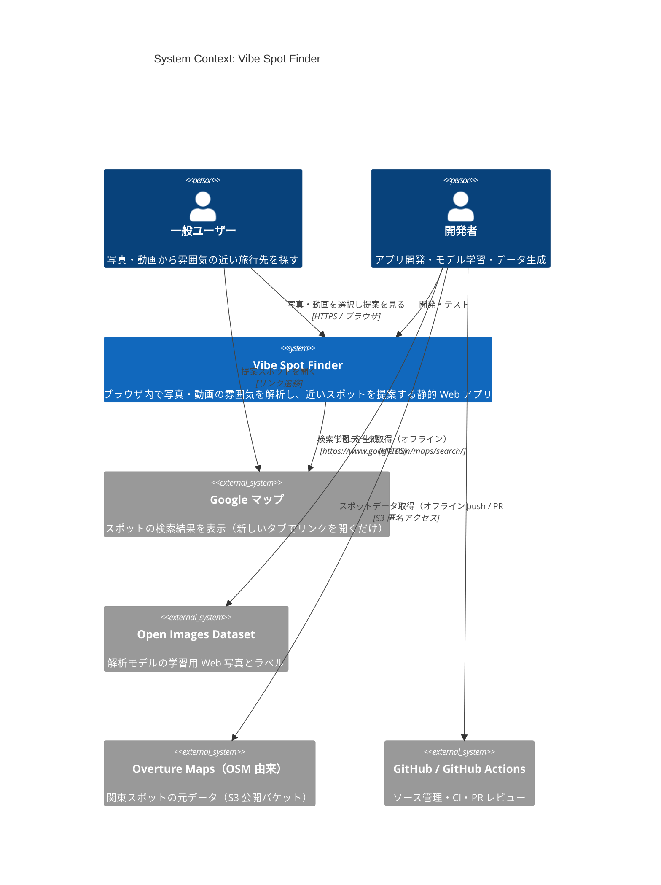
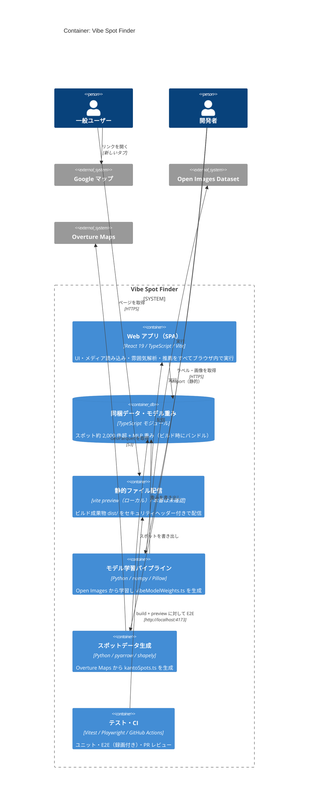
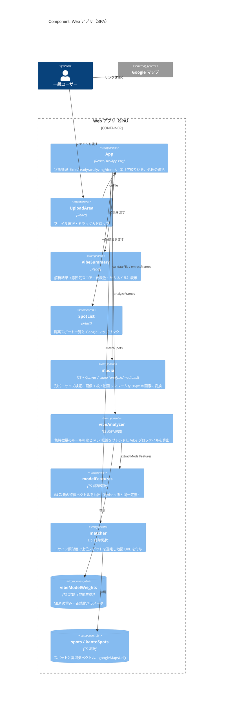
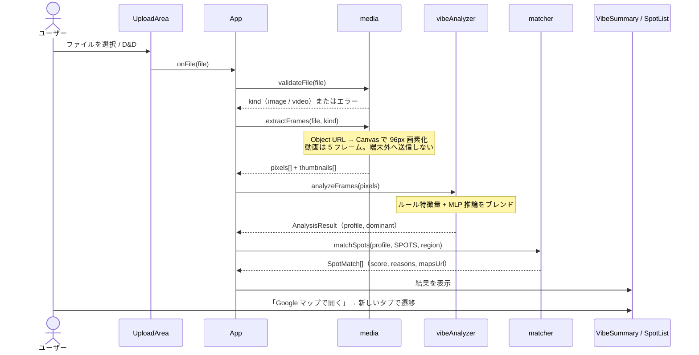
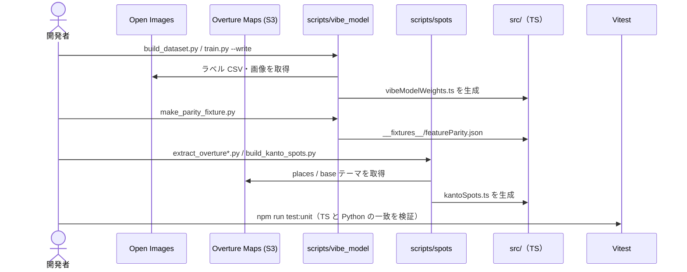

# アーキテクチャ（C4 モデル）

本書は Vibe Spot Finder の構成を [C4 モデル](https://c4model.com/) の Level 1〜3 で示す。
記述はリポジトリ内のコード・設定に基づく。コードから確認できない事項は「未確認」と明記する。

- 仕様: [SPEC.md](SPEC.md) / セキュリティ: [SECURITY.md](SECURITY.md) / テスト: [TEST_CASES.md](TEST_CASES.md)

## 1. 概要

### 目的

写真・動画の **雰囲気（色味・明暗・質感）** をブラウザ内で解析し、雰囲気が近い国内スポットを
**Google マップの検索リンク付き** で提案する。ファイルは端末外へ送信しない（SPEC N-01 / SECURITY SR-01）。

### 主な利用者

| 利用者 | 内容 |
|---|---|
| 一般ユーザー | 写真・動画を選択（またはドラッグ＆ドロップ）し、提案されたスポットを Google マップで開く |
| 開発者 | アプリの開発・テスト、解析モデルの再学習、関東スポットデータの再生成を行う |

### 技術スタック

| 区分 | 技術 | 根拠 |
|---|---|---|
| 言語 | TypeScript 5.9 | `package.json`, `tsconfig*.json` |
| UI | React 19.1（`react`, `react-dom`） | `package.json`, `src/main.tsx` |
| ビルド / 開発サーバー | Vite 7.3 + `@vitejs/plugin-react` | `vite.config.ts` |
| ブラウザ API | Canvas 2D（画素取得）、`<video>`（フレーム抽出）、Object URL | `src/analysis/media.ts` |
| 解析モデル | 84 → 64 → 7 の MLP（重みを TS に同梱、推論は純 TS） | `src/analysis/vibeAnalyzer.ts`, `vibeModelWeights.ts` |
| ユニットテスト | Vitest 4.1（Node 環境） | `vite.config.ts` の `test` |
| E2E テスト | Playwright 1.56（Chromium、全テスト録画） | `playwright.config.ts` |
| CI | GitHub Actions（E2E / Claude Code Review） | `.github/workflows/` |
| データ生成・学習（オフライン） | Python 3（numpy, Pillow, pyarrow, shapely） | `scripts/` |
| バックエンド / DB / 認証 | **なし**（静的 SPA。API・DB・認証のコードは存在しない） | リポジトリ全体 |
| 本番ホスティング | **未確認**（Dockerfile・IaC・デプロイ設定はリポジトリに無い。SECURITY.md は「CDN・静的ホスティング」を想定） | `docs/SECURITY.md` SR-11/12 |

## 2. Level 1: System Context 図



| 名前 | 種別 | 技術 | 責務 |
|---|---|---|---|
| 一般ユーザー | Person | Web ブラウザ | メディアを読み込ませ、提案されたスポットを閲覧・Google マップで開く |
| 開発者 | Person | Node.js / Python | アプリ開発、モデル再学習、スポットデータ再生成、テスト |
| Vibe Spot Finder | System | React + TypeScript（静的 SPA） | 雰囲気解析とスポット推薦。**実行時の外部通信なし**（CSP `connect-src 'none'`） |
| Google マップ | External System | Web | 生成された検索リンクの遷移先。アプリからの API 呼び出しは無い |
| Open Images Dataset | External System | GCS / S3 上の CSV・画像 | 学習データ源。画像は再配布せず学習済み重みのみ同梱 |
| Overture Maps | External System | S3 上の GeoParquet | 関東 2,000 スポットの元データ（© OpenStreetMap contributors, ODbL） |
| GitHub / GitHub Actions | External System | GitHub | ソース管理と PR 時の CI（型チェック・テスト・E2E・Claude Code Review） |

## 3. Level 2: Container 図



| 名前 | 種別 | 技術 | 責務 |
|---|---|---|---|
| Web アプリ（SPA） | Container | React 19, TypeScript, Vite 7 | ファイル検証、フレーム抽出、特徴量計算、MLP 推論、スポット照合、結果表示。エントリポイントは `index.html` → `src/main.tsx` → `src/App.tsx` |
| 同梱データ・モデル重み | Container（静的データ） | TS モジュール | `src/data/spots.ts`（全国の代表スポット）、`src/data/kantoSpots.ts`（自動生成・関東 2,000 件）、`src/analysis/vibeModelWeights.ts`（自動生成・重み）。**DB は使わない** |
| 静的ファイル配信 | Container | `vite preview`（ポート 4173） / 本番は **未確認** | `vite.config.ts` の `SECURITY_HEADERS`（CSP・X-Frame-Options 等）を付与。ビルド時に CSP を meta で埋め込む |
| モデル学習パイプライン | Container（オフラインバッチ） | Python 3, numpy, Pillow | `scripts/vibe_model/`。データセット構築 → 学習 → TS への重み出力 → TS/Python の特徴量一致フィクスチャ生成 |
| スポットデータ生成 | Container（オフラインバッチ） | Python 3, pyarrow, shapely | `scripts/spots/`。Overture の places / base テーマを抽出し、種別判定・雰囲気付与・選別して TS を出力 |
| テスト・CI | Container | Vitest, Playwright, GitHub Actions | `e2e.yml`（typecheck・unit・E2E、retries=0）、`claude-code-review.yml`（PR レビュー）。E2E 動画は `e2e/recordings/` に保存 |

> サーバーサイド API、データベース、オブジェクトストレージ、認証基盤、外部 SaaS への実行時接続は **存在しない**。

## 4. Level 3: Component 図（Web アプリ）



| 名前 | 種別 | 技術 | 責務 |
|---|---|---|---|
| App | Component | React（`src/App.tsx`） | 選択ファイル・状態・エラー・結果・エリアを保持し、検証 → 抽出 → 解析 → 照合を順に呼ぶ。Object URL の解放、結果への自動スクロール |
| UploadArea | Component | React（`src/components/UploadArea.tsx`） | ファイル入力と D&D を受け付け `onFile` を通知 |
| VibeSummary | Component | React（`src/components/VibeSummary.tsx`） | 雰囲気スコア・代表色・フレームサムネイルを表示 |
| SpotList | Component | React（`src/components/SpotList.tsx`） | 一致度・理由・説明・「Google マップで開く」リンク（`noopener noreferrer`）を表示 |
| media | Component | TS + DOM（`src/analysis/media.ts`） | 許可 MIME（JPEG/PNG/WebP/GIF、MP4/WebM/QuickTime）とサイズ上限（画像 20MB・動画 200MB）を検証。Canvas で画素化、動画は 5 フレーム抽出、イベント待ちは 15 秒でタイムアウト |
| vibeAnalyzer | Component | TS 純粋関数（`src/analysis/vibeAnalyzer.ts`） | 色特徴量（明度・彩度・暖色比率等）のルールスコアと MLP 出力を、輝度勾配に応じた係数でブレンド。主要 Vibe（しきい値 0.3）を選ぶ |
| modelFeatures | Component | TS 純粋関数（`src/analysis/modelFeatures.ts`） | 84 次元特徴ベクトル。`scripts/vibe_model/features.py` と一致することを Vitest のフィクスチャで検証 |
| matcher | Component | TS 純粋関数（`src/analysis/matcher.ts`） | 地域フィルタ、コサイン類似度（最小 0.2）、上位 6 件、寄与上位 2 Vibe を理由として返す |
| vibeModelWeights | Component（データ） | TS 定数 | `scripts/vibe_model/train.py --write` で生成 |
| spots / kantoSpots | Component（データ） | TS 定数 | 全国の代表スポット + `scripts/spots/build_kanto_spots.py` で生成した関東スポット。`googleMapsUrl()` で検索 URL を作る |

Vibe は `ocean / forest / sunset / night / snow / retro / vivid` の 7 種（`src/analysis/types.ts`）。

## 5. 主要なデータフロー

### 5.1 メディア解析とスポット提案（実行時）



### 5.2 オフラインのデータ・モデル更新



### 5.3 PR 時の CI

PR の作成・更新で `e2e.yml` が `npm ci` → typecheck → unit → `npm run build && npm run preview` に対する Playwright E2E（retries=0）を実行し、
レポートと動画を Artifact に保存する。`claude-code-review.yml` はドラフト以外の PR で Claude Code のレビューを PR にコメントする。

## 6. ディレクトリ構成

```
.
├── index.html                   エントリ HTML（referrer 無効化、/src/main.tsx を読み込む）
├── vite.config.ts               Vite 設定・CSP / セキュリティヘッダー・Vitest 設定
├── playwright.config.ts         E2E 設定（build + preview、全テスト録画）
├── src/                         Web アプリ本体
│   ├── main.tsx                 React のマウント
│   ├── App.tsx                  画面と処理の統括
│   ├── styles.css               スタイル
│   ├── components/              UI コンポーネント（UploadArea / VibeSummary / SpotList）
│   ├── analysis/                解析・推薦ロジック（DOM 依存は media.ts のみ）と Vitest テスト
│   │   └── __fixtures__/        TS / Python の特徴量一致検証データ
│   └── data/                    スポットデータ（spots.ts、自動生成の kantoSpots.ts）
├── e2e/                         Playwright テスト
│   ├── *.spec.ts                TC-xx に対応するテスト
│   ├── helpers.ts               共通操作
│   ├── fixtures/                テスト用画像・動画・不正ファイル
│   ├── reporters/               録画を recordings/ に保管するレポーター
│   └── recordings/              操作キャプチャ動画と一覧
├── scripts/                     オフラインツール（Python）
│   ├── generate_fixtures.py     E2E フィクスチャ生成
│   ├── vibe_model/              解析モデルの学習
│   └── spots/                   関東スポットデータの生成
├── docs/                        仕様書・セキュリティ要件・テストケース・本書
└── .github/workflows/           CI（E2E、Claude Code Review）
```

## 7. 未確認事項

| 項目 | 状況 |
|---|---|
| 本番のホスティング先・デプロイ手順 | リポジトリに Dockerfile / IaC / デプロイワークフローが無く未確認。SECURITY.md SR-11/12 にヘッダーと HTTPS の要件のみ記載 |
| 本番でのセキュリティヘッダー付与方法 | 同上（`vite preview` での付与のみ確認） |
